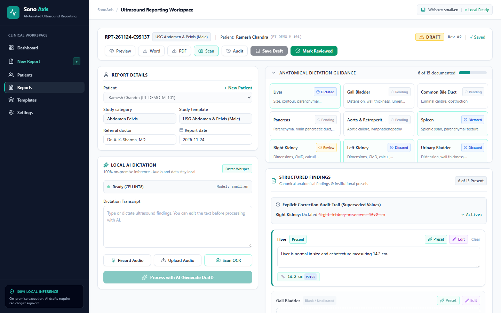
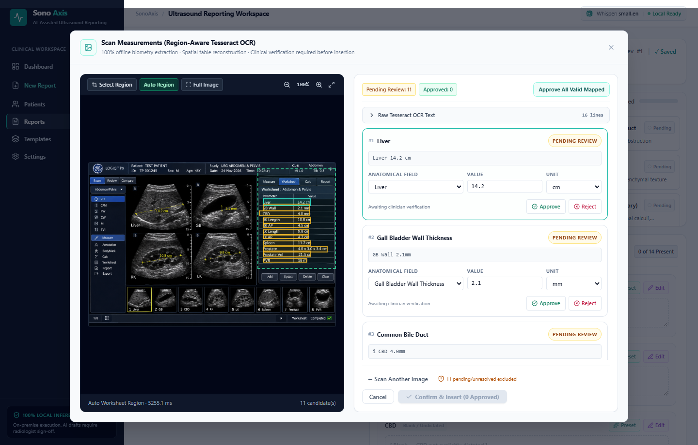
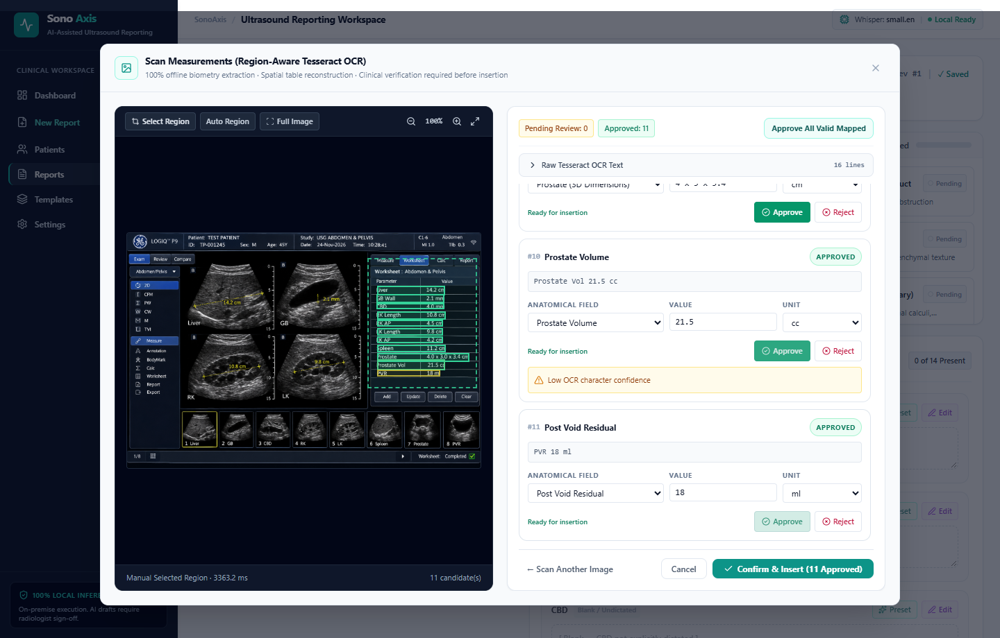
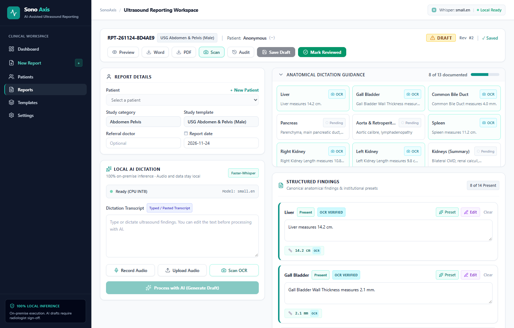
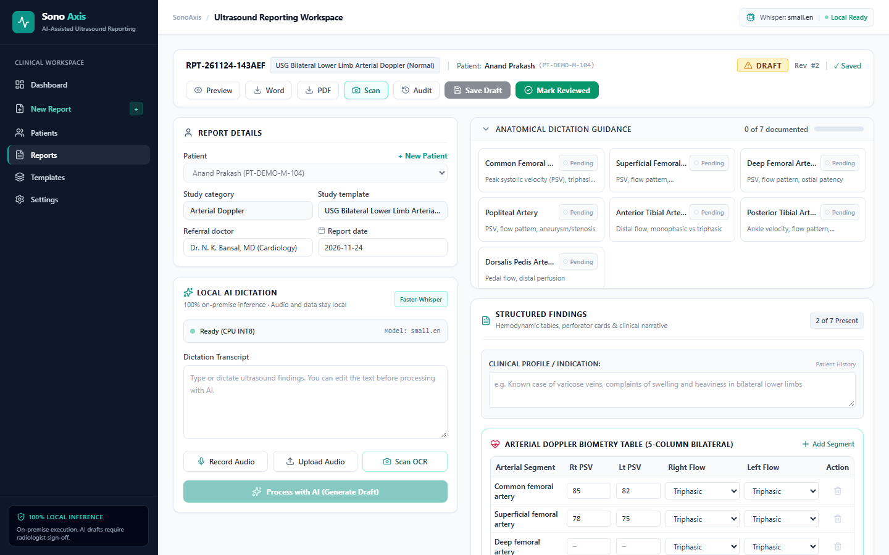
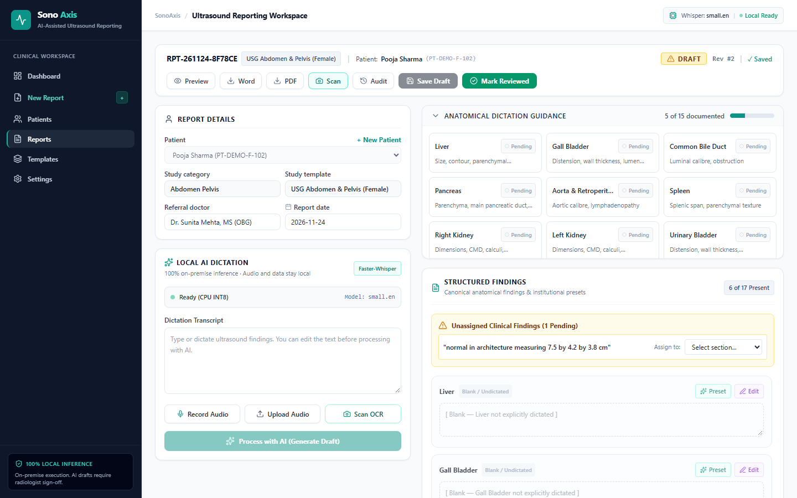
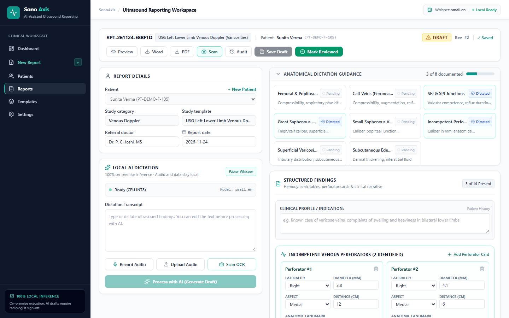
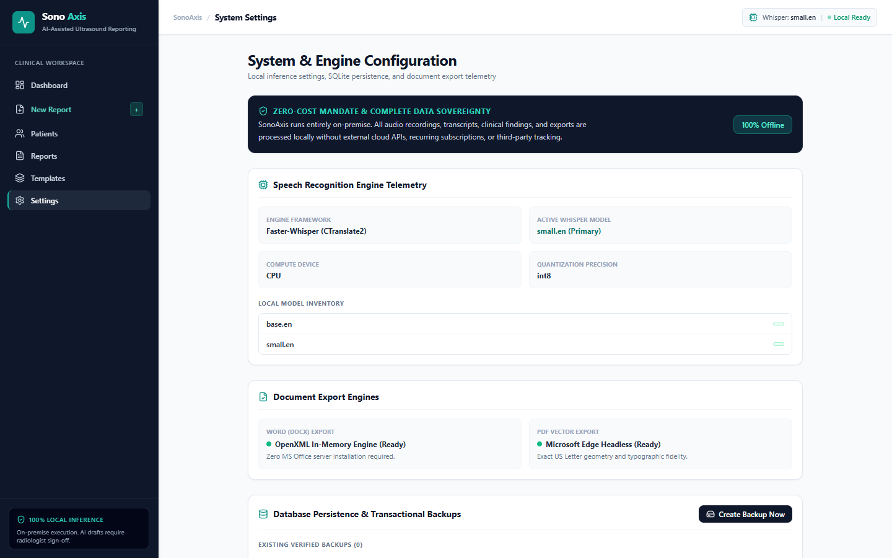
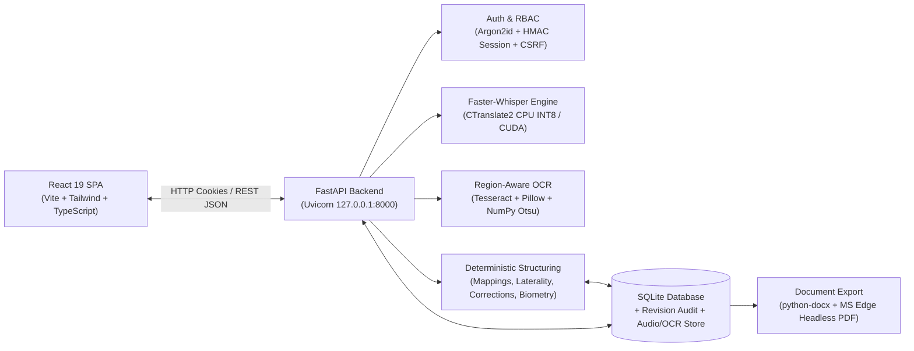
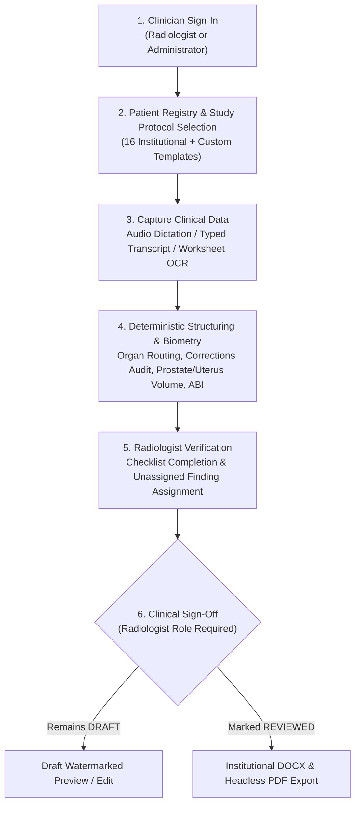

# SonoAxis

**AI-Assisted Ultrasound Reporting — Local-First Clinical Voice, Worksheet OCR & Structured Documentation Suite**


SonoAxis is a local-first clinical ultrasound reporting workstation application built for radiologists, sonographers, and diagnostic imaging practices. It converts spoken clinical dictations and scanned ultrasound machine measurement worksheets into structured, review-gated reports exported in institutional Word (`.docx`) and PDF formats — running entirely on the workstation without paid cloud APIs or external telemetry.

---

## Clinical Overview & Problem Statement

Diagnostic ultrasound workflows frequently suffer from four operational bottlenecks:

1. **Manual Reporting Overhead:** Dictating, formatting, and re-typing organ measurements consumes significant specialist reporting time.
2. **Transcription Errors from Printouts:** Manually copying multiple biometry values from thermal slips or ultrasound monitor worksheets risks digit-transposition mistakes.
3. **Generative LLM Hallucination Risk:** General-purpose generative models can fabricate "normal" findings for unexamined organs if an organ was omitted from dictation.
4. **Cloud Privacy & Recurring API Costs:** Sending patient identifiers and audio recordings to external APIs introduces compliance scope and ongoing per-study fees.

SonoAxis addresses these challenges through **local speech inference (`Faster-Whisper`)**, **deterministic rule-based clinical structuring**, **region-aware local OCR (`Tesseract`)**, and **mandatory radiologist sign-off (`DRAFT` -> `REVIEWED`)**.

---

## Core Capabilities

| Domain | Capabilities |
| :--- | :--- |
| **Local Speech Recognition** | On-device transcription powered by `Faster-Whisper` (`CTranslate2`) running `CPU INT8` by default with automatic CUDA `float16` detection when available; multi-recording incremental takes and word-level timing support |
| **Deterministic Clinical Structuring** | Rule-based NLP segmenter, organ alias matcher, negation preservation, strict right/left laterality isolation, verbal correction resolution (*"correction"*, *"make that"*, *"actually"*), immutable correction audit trail, and zero fabrication of blank sections |
| **Anatomical Guidance & Presets** | Interactive per-protocol checklist tracking documented vs. pending sections, one-click institutional normal presets with provenance chips (`Dictated`, `Preset`, `OCR Verified`, `Manual`), and unassigned finding resolution |
| **Region-Aware Worksheet OCR** | 100% local `Tesseract` + `Pillow` + pure `NumPy` Otsu thresholding pipeline supporting automatic worksheet region detection, manual rectangular crop selection, spatial row-level label/value pairing, duplicate filtering, inline editing, and per-item clinician approval |
| **Automated Clinical Biometry** | Deterministic formulas for Prostate Ellipsoid Volume (Terris & Stamey 1991), Uterine Ellipsoid Volume (Merz et al. 1996), Pre/Post-Void Bladder Residual, Carotid ICA/CCA Velocity Ratio (SRU 2003), and Ankle-Brachial Index (2024 ACC/AHA PAD Guideline with strict velocity rejection) |
| **Protocol & Custom Templates** | 16 built-in ultrasound protocols (Abdomen & Pelvis, Venous, Arterial, Arteriovenous Doppler) plus single/bulk `.docx` import with VBA macro rejection, draft/approved/archived lifecycle, versioning, and radiologist custom template ownership |
| **Review Gating & Institutional Exports** | Reports initialize in `DRAFT` with clear watermark warnings; radiologist sign-off transitions studies to `REVIEWED` before generating Word (`.docx`) and US-Letter PDF exports via Microsoft Edge Headless |
| **Authentication & Auditability** | Workstation login protected by `Argon2id` password hashing, HMAC-SHA256 signed `HttpOnly` session cookies, `X-CSRF-Token` validation, login rate limiting, role-based access control (`Radiologist`, `Administrator`), revision history, and native SQLite online backups |

---

## Visual Showcase

> **Note on captures:** The screenshots below are authentic captures from the local SonoAxis web application using fictional demonstration data (`Ramesh Chandra`, `Pooja Sharma`, `Anand Prakash`, `Sunita Verma`, and synthetic `TEST PATIENT` GE LOGIQ-style worksheets). They illustrate pre-authentication workspace layouts; clinician login and sidebar account controls operate over all protected routes in the current build. No live passwords, patient PHI, or local credentials appear in these images.

### Structured Abdomen & Pelvis Workspace & Correction Audit Trail


### Region-Aware Ultrasound Worksheet OCR Verification
| Automatic Region Detection & Pending Review | Manual Region Selection & Approved Extraction |
| :---: | :---: |
|  |  |

### Confirmed OCR Provenance & Vascular Doppler Workflows
| Workspace Populated from Verified OCR | Bilateral Arterial 5-Column Hemodynamic Table |
| :---: | :---: |
|  |  |

| Female Pelvis & Unassigned Finding Assignment | Venous Doppler Incompetent Perforator Cards |
| :---: | :---: |
|  |  |

### Local Engine & Export Telemetry


---

## System Architecture

SonoAxis uses a decoupled single-workstation client-server topology bound strictly to loopback (`127.0.0.1:8000`) in production mode, serving the compiled React SPA directly from FastAPI.



See [docs/ARCHITECTURE.md](docs/ARCHITECTURE.md) for module boundaries, database tables, and static-serving details.

---

## Clinical Workflow



---

## Supported Clinical Protocols (16 Built-In Institutional Templates)

All 16 built-in templates are seeded into `examination_templates` at database startup with protection against accidental modification or deletion:

| Template ID | Examination Protocol | Category | Laterality | Table / Card Mode |
| :--- | :--- | :--- | :--- | :--- |
| `usg-abdomen-pelvis-male` | USG Abdomen & Pelvis (Male) | `abdomen_pelvis` | Not Applicable | Standard sections |
| `usg-abdomen-pelvis-female` | USG Abdomen & Pelvis (Female) | `abdomen_pelvis` | Not Applicable | Standard sections |
| `usg-doppler-venous-left-varicose` | USG Left Lower Limb Venous Doppler (Varicosities) | `venous_doppler` | Left | Perforator cards |
| `usg-doppler-venous-right-varicose` | USG Right Lower Limb Venous Doppler (Varicosities) | `venous_doppler` | Right | Perforator cards |
| `usg-doppler-venous-left-thrombosis` | USG Left Lower Limb Venous Doppler (Thrombosis) | `venous_doppler` | Left | Standard sections |
| `usg-doppler-venous-bilateral-normal` | USG Bilateral Lower Limb Venous Doppler (Normal) | `venous_doppler` | Bilateral | Standard sections |
| `usg-doppler-venous-bilateral-varicose` | USG Bilateral Lower Limb Venous Doppler (Varicosities) | `venous_doppler` | Bilateral | Perforator cards |
| `usg-doppler-venous-bilateral-detailed` | USG Bilateral Lower Limb Venous Doppler (Detailed Varicose) | `venous_doppler` | Bilateral | Perforator cards |
| `usg-doppler-venous-right-dvt` | USG Right Lower Limb Venous Doppler (DVT Follow-up) | `venous_doppler` | Right | Standard sections |
| `usg-doppler-venous-right-normal` | USG Right Lower Limb Venous Doppler (Normal) | `venous_doppler` | Right | Standard sections |
| `usg-doppler-arterial-right-normal` | USG Right Lower Limb Arterial Doppler (Normal) | `arterial_doppler` | Right | `arterial_3col_table` |
| `usg-doppler-arterial-bilateral-normal` | USG Bilateral Lower Limb Arterial Doppler (Normal) | `arterial_doppler` | Bilateral | `arterial_5col_table` |
| `usg-doppler-arterial-bilateral-thrombus` | USG Bilateral Lower Limb Arterial Doppler (Thrombus) | `arterial_doppler` | Bilateral | `arterial_5col_tabs` |
| `usg-doppler-arterial-right-pvd` | USG Right Lower Limb Arterial Doppler (PVD) | `arterial_doppler` | Right | `arterial_3col_tabs` |
| `usg-doppler-av-right` | USG Right Lower Limb Arteriovenous Doppler | `arteriovenous_doppler` | Right | `arterial_3col_tabs` |
| `usg-doppler-av-bilateral-thrombosis` | USG Bilateral Lower Limb Arteriovenous Doppler (Thrombosis) | `arteriovenous_doppler` | Bilateral | Standard sections |

> **Institutional Stationery Provisioning:** Original institutional `.docx` letterhead files referenced by `TEMPLATES_CATALOG` are intentionally excluded from version control in `.gitignore` to protect institutional branding and clinician signatures. See [docs/INSTALLATION.md](docs/INSTALLATION.md) for local `.docx` template placement.

---

## Technology Stack

- **Backend API:** Python 3.12+, FastAPI (`>=0.115.0`), Uvicorn (`>=0.32.0`), Pydantic v2 (`>=2.9.0`), Pydantic Settings (`>=2.6.0`)
- **Frontend UI:** React 19 (`^19.3.1`), React Router (`^7.18.6`), TypeScript (`~7.0.2`), Vite (`^8.3.6`), Tailwind CSS (`^3.4.19`), Lucide React
- **Speech Recognition:** `faster-whisper` (`>=1.0.3`), `ctranslate2`, `av` (`==13.1.0`), `soundfile`
- **Worksheet OCR:** `pytesseract` (`>=0.3.13`), Tesseract OCR binary, `pillow` (`>=11.0.0`), `numpy` (`>=1.26.0,<2.1.0`)
- **Authentication:** `argon2-cffi` (`>=25.1.0`, Argon2id `t=3, m=65536, p=2`), HMAC-SHA256 session cookies, CSRF double-submit verification
- **Database & Exports:** SQLite 3 (WAL/transactional backup API), `python-docx` (`>=1.1.0`), Microsoft Edge Headless (`--print-to-pdf`)
- **Testing:** `pytest` (`>=8.3.0`), `httpx` (`>=0.27.0`)

---

## Repository Structure

```text
SonoAxis/
├── backend/
│   └── app/
│       ├── api/            # Public & protected FastAPI routers, auth/CSRF dependencies
│       ├── core/           # Pydantic runtime settings (config.py)
│       ├── db/             # SQLite schema, migrations, and repository classes
│       ├── export/         # DOCX OpenXML rendering, HTML preview, Edge PDF generation
│       ├── ocr/            # Image validation, Otsu preprocessing, region detection & mapping
│       ├── schemas/        # Pydantic request/response contracts
│       ├── services/       # Auth, Whisper STT, patients, reports, templates, backups, demo seed
│       ├── structuring/    # Deterministic NLP segmentation, laterality, corrections, biometry
│       ├── cli_accounts.py # Workstation CLI for doctor account setup & password rotation
│       └── main.py         # FastAPI entry point + compiled SPA static host
├── frontend/
│   └── src/                # React 19 TypeScript application (Auth, Workspace, OCR Modal, Templates)
├── docs/
│   ├── screenshots/        # Verified PII-free UI screenshots
│   ├── ARCHITECTURE.md
│   ├── INSTALLATION.md
│   ├── USER_GUIDE.md
│   ├── SECURITY.md
│   ├── API.md
│   └── TESTING.md
├── tests/                  # Automated regression suite (193 tests across backend, OCR, RBAC, exports)
├── .env.example            # Safe template of runtime environment variables
├── .gitignore              # Excludes DBs, keys, audio/OCR uploads, Whisper weights, clinic .docx files
├── pytest.ini
├── requirements.txt
└── start_sonoaxis.bat      # Windows production server launcher
```

---

## Quick Start (Windows Workstation)

For complete prerequisites, system dependencies, model setup, and known portability paths, see [docs/INSTALLATION.md](docs/INSTALLATION.md).

```powershell
# 1. Clone the repository and enter the project directory
git clone https://github.com/mangesh-lomte/SonoAxis.git
cd SonoAxis

# 2. Create and activate Python virtual environment
python -m venv .venv
.\.venv\Scripts\Activate.ps1

# 3. Install backend Python dependencies
pip install -r requirements.txt

# 4. Build production React frontend
cd frontend
npm install
npm run build
cd ..

# 5. Initialize database schema and configure workstation doctor accounts interactively
python -m backend.app.cli_accounts init-demo

# 6. Start SonoAxis on localhost loopback (http://127.0.0.1:8000/)
.\.venv\Scripts\uvicorn.exe backend.app.main:app --host 127.0.0.1 --port 8000
```

> **Windows One-Click Launcher:** Once provisioned with `.venv`, `frontend\dist`, Tesseract OCR, Whisper models, and local accounts, double-click `start_sonoaxis.bat` to launch Uvicorn cleanly and open `http://127.0.0.1:8000/`.

---

## Configuration, Authentication & Security

- **Configuration Variables:** Runtime parameters (`SONOVOICE_APP_HOST`, `SONOVOICE_APP_PORT`, `SONOVOICE_DEFAULT_MODEL`, `SONOVOICE_STT_DEVICE`, `SONOVOICE_STT_COMPUTE_TYPE`, storage paths) are documented in [`.env.example`](.env.example).
- **Local CLI Provisioning:** No hardcoded plaintext login passwords ship in source code. Operators provision or rotate credentials locally via `python -m backend.app.cli_accounts` (`init-demo`, `create-user`, `reset-password`, `list-users`).
- **Role-Based Access Control:**
  - `Radiologist`: Full clinical workflow, custom template import/editing/versioning, clinical sign-off (`DRAFT` -> `REVIEWED`), revert draft, DOCX/PDF export.
  - `Administrator`: User account provisioning/status control, shared institutional template approval/archiving, database backup creation and non-destructive restore verification, system settings. Admin accounts cannot finalize clinical medical reports (`POST /reports/{id}/review`).
- **Clinical & Security Disclosures:**
  - **Clinical Draft Mandate:** Generated transcripts, structured text, and OCR candidates are strictly preliminary drafts requiring verified clinician sign-off.
  - **At-Rest Encryption Boundary:** SQLite (`sonovoice.db`), uploaded audio files, and uploaded worksheet images are stored unencrypted on the host filesystem; full-disk encryption (e.g., Windows BitLocker) and OS account isolation are required at deployment.
  - **Regulatory Scope:** SonoAxis is an assistive clinical documentation tool and is not an FDA-cleared, CE-marked, HIPAA-certified, or ABDM-certified medical device.

Read [docs/SECURITY.md](docs/SECURITY.md) and [docs/USER_GUIDE.md](docs/USER_GUIDE.md) for full details.

---

## API & Testing Summary

- **REST API:** All clinical and administrative routes under `/api/*` require a valid authenticated session (`sonoaxis_session` HttpOnly cookie + `X-CSRF-Token`, or `Authorization: Bearer <token>`) except `POST /api/auth/login`, `POST /api/auth/logout`, and `GET /api/health`. Full reference in [docs/API.md](docs/API.md).
- **Automated Verification:**

```powershell
.\.venv\Scripts\pytest.exe tests
```

See [docs/TESTING.md](docs/TESTING.md) for test coverage breakdown across structuring, biometry, OCR extraction, authentication/RBAC, exports, and backups.

---

## Project Demonstration

* **Status:** Internal demonstration media placeholder.
* **Walkthrough Video / Recording:** *Link to be added upon internal manager submission.*
* **Demo Environment Initialization:** Authorized reviewers with a local checkout can seed 6 fictional demonstration patients (`MRN-2026-1041` through `MRN-2026-1046`) using the non-destructive CLI account workflow (`backend.app.cli_accounts init-demo`) and `backend/app/services/demo_seed.py`.

---

## Known Limitations & Portability Notes

- Several backend modules (`ocr/engine.py`, `ocr/extractor.py`, `services/auth_service.py`, `api/endpoints.py`) and test scripts still contain default `D:/sovoice/...` path literals or `D:\tools\tesseract\tesseract.exe` candidate paths, and PDF export depends on a local Microsoft Edge executable (`msedge.exe`). See [docs/INSTALLATION.md](docs/INSTALLATION.md) before installing outside `D:\sovoice`.
- SQLite concurrency is designed for single-workstation local deployment rather than multi-tenant hospital network servers.
- Institutional letterhead DOCX injection in `backend/app/export/word_service.py` expects locally provisioned stationery files under `references/` matching `TEMPLATES_CATALOG` filenames.

---

## Ownership & Usage Notice

This repository contains the public source release of SonoAxis published for engineering showcase, architectural evaluation, and demonstration review. **No open-source license (`MIT`, `Apache`, `GPL`, or similar) is granted.** All rights, institutional clinical templates, and downstream distribution permissions remain reserved by the project owner unless explicitly licensed in the future.

For further architectural and operational documentation, see:
[Architecture](docs/ARCHITECTURE.md) | [Installation](docs/INSTALLATION.md) | [User Guide](docs/USER_GUIDE.md) | [Security](docs/SECURITY.md) | [API Reference](docs/API.md) | [Testing](docs/TESTING.md)
