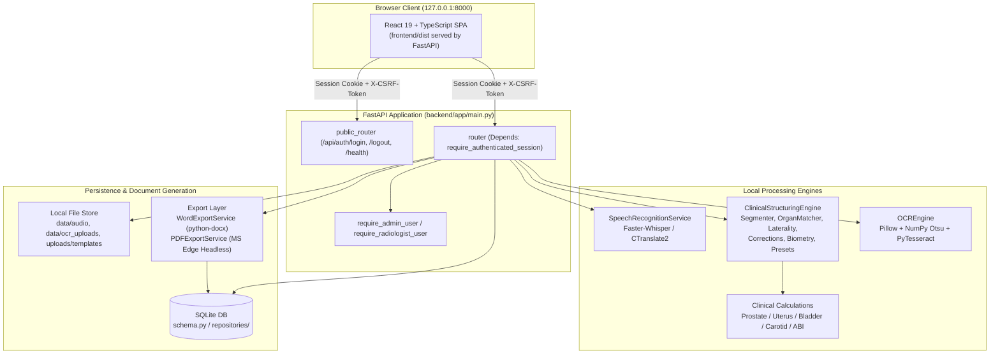

# SonoAxis Architecture

## 1. Architectural Goals

SonoAxis is engineered as a **single-workstation, local-first clinical ultrasound documentation server**:

- **Zero external AI / cloud dependencies:** Speech recognition, OCR, deterministic NLP, biometry calculations, storage, and DOCX/PDF rendering execute locally on the host CPU (with optional CUDA for Faster-Whisper).
- **Predictable clinical outputs:** Natural language structuring avoids open-ended generative prose so omitted organs remain explicitly blank rather than silently defaulted to normal.
- **Explicit separation between public and authenticated APIs:** All clinical and administrative routes are mounted on a protected FastAPI `APIRouter`.

---

## 2. High-Level Component Diagram

---

## 3. Backend Module Breakdown (`backend/app/`)

| Package / Module | Responsibility | Key Files |
| :--- | :--- | :--- |
| **API Layer** | Authentication, CSRF enforcement, role guards, REST routes, file upload bounds | `api/endpoints.py` |
| **Core Configuration** | `Settings` via `pydantic-settings` (`SONOVOICE_*` environment prefix) | `core/config.py` |
| **Database Layer** | Connection helper, WAL/foreign-key pragmas, idempotent DDL migrations, repositories | `db/connection.py`, `db/schema.py`, `db/repositories/*` |
| **Auth & Security Services** | Argon2id hashing (`argon2-cffi`), HMAC-SHA256 session tokens, CSRF tokens, rate limiting | `services/auth_service.py`, `cli_accounts.py` |
| **Speech Service** | `WhisperModel` lazy loading, CPU `int8` / CUDA fallback, audio transcription | `services/speech_service.py`, `services/audio_storage.py` |
| **Structuring Engine** | Text segmentation, organ routing, vascular table/perforator parsing, correction history, unassigned items | `structuring/{engine,segmenter,organ_matcher,laterality,corrections,biometry,vascular,presets,checklist}.py` |
| **Biometry Calculations** | Verified ellipsoid volume and vascular ratio formulas | `structuring/calculations.py` |
| **Template Governance** | 16 built-in catalog definitions (`TEMPLATES_CATALOG`), DOCX XML structure extraction, macro rejection, versioning | `structuring/templates.py`, `services/template_service.py` |
| **OCR Pipeline** | Image bomb validation (`25 MP` / `15 MB`), 1.8x contrast + Otsu binarization, border cleaning, spatial row/table pairing | `ocr/{engine,preprocessing,extractor}.py` |
| **Export Pipeline** | HTML institutional preview, `python-docx` paragraph/table injection, Edge headless PDF render | `export/{preview_service,word_service,pdf_service}.py` |
| **Backup & Demo Seed** | Native SQLite online backup API (`sqlite3.Connection.backup`), `PRAGMA integrity_check`, demo data reset | `services/backup_service.py`, `services/demo_seed.py` |

---

## 4. SQLite Schema (`backend/app/db/schema.py`)

Core normalized tables initialized idempotently at startup (`CURRENT_SCHEMA_VERSION = 1`):

- `users` — Doctor and administrator accounts (`id`, `username`, `password_hash`, `full_name`, `credentials`, `designation`, `role`, `department`, `email`, `is_active`, `is_demo`, timestamps).
- `user_sessions` — Active and revoked session digests (`id`, `user_id`, `token_hash`, `csrf_token`, `expires_at`, `revoked`).
- `patients` — Patient directory (`id`, `patient_id` MRN unique key, `full_name`, `age_years`, `gender`, `contact_number`, `clinical_notes`).
- `examination_templates` — Institutional (`is_built_in = 1`, `is_shared = 1`) and custom imported/radiologist-owned templates (`id`, `name`, `category`, `laterality`, `canonical_sections`, `table_type`, `status`, `version`, `created_by_user_id`, `doc_structure_json`).
- `reports` — Core report state (`id`, `patient_id`, `template_id`, `report_number`, `report_date`, `referral_doctor`, `status` [`DRAFT` | `REVIEWED`], `patient_snapshot`, transcripts, `structured_findings` JSON, `impression`, `revision_number`, `is_reviewed`, `reviewed_by`, `reviewed_at`).
- `structured_findings` — Normalized per-organ finding records and supersession tracking (`is_superseded`, `superseded_by_id`, audio timestamps).
- `unassigned_findings` — Clinical sentences not confidently routed to a target organ pending manual assignment or exclusion.
- `report_revisions` — Immutable JSON snapshots on every draft update, review transition, or revert action.
- `audio_recordings` — Stored audio metadata linked to `reports.id`.
- `app_settings` — Runtime configuration pairs (`stt_model`, `device`, `compute_type`, `audio_retention_days`, `require_review_acknowledgment`).

---

## 5. Frontend Architecture (`frontend/src/`)

- Built with **React 19**, **TypeScript**, **React Router**, and **Tailwind CSS**, bundled via **Vite** into `frontend/dist/`.
- FastAPI serves `/assets` statically and routes unmatched paths through `serve_spa()` with `Cache-Control: no-cache, no-store, must-revalidate` on `index.html`.
- `AuthContext` manages login state (`GET /api/auth/me`) and attaches CSRF headers on cookie-backed mutations (`POST`, `PUT`, `PATCH`, `DELETE`).
- Key workspace screens: Clinician Login (`/login`), Clinical Dashboard, Patient Directory, Report Workspace (dictation, editable transcript, anatomical guidance grid, structured section cards, vascular hemodynamic tables, perforator cards, OCR verification modal, revision audit drawer, live HTML/DOCX/PDF export), Institutional & Custom Template Library, and Settings/Backups/User Governance.
